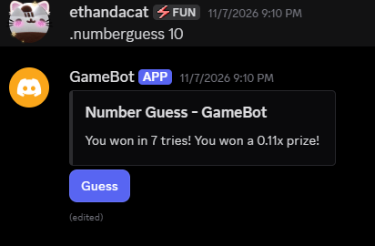
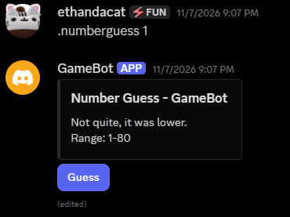
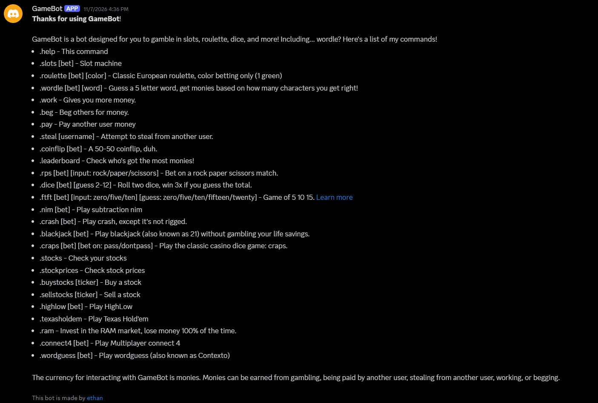
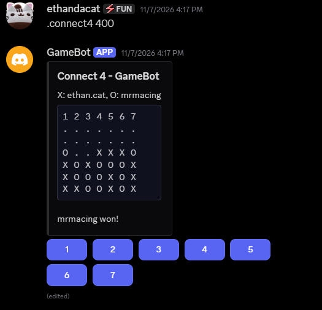
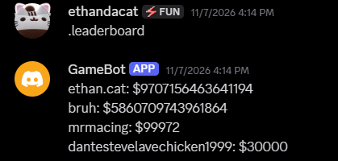
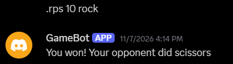
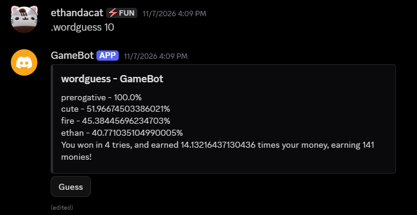
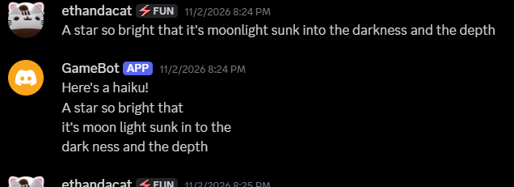
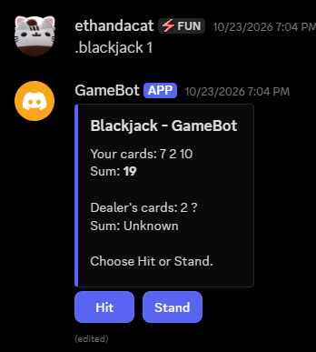
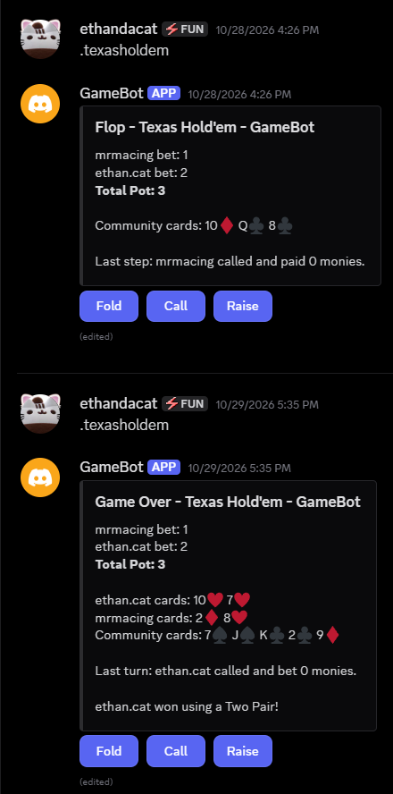

# GameBot
GameBot is a bot that can let you gamble and lose all of your fictional money!
Includes blackjack, texas holdem, connect four, wordle, and so much more.

## Screenshots











## Getting Started
### Dependencies
Python 3.13.5 is the only tested version, however all versions 3.12+ should work theoretically.
You need the Gensim, Pyphen, and Discord.py libraries. You can install them using these commands.
```
pip install gensim
pip install pyphen
pip install discord.py
```
### Other Prerequisites
Create a bot in Discord and enter the bot token inside of credentials-example.txt. Then, rename it to credentials.txt.
Rename monies-example.txt to monies.txt and delete the entire text content.

### How to Run
To run the code, simply run `python main.py` in the main folder.
On the first run, GameBot downloads the GloVe word vectors that `.wordguess` needs and caches them as `glove50.kv` and `glove50.kv.vectors.npy` (about 87 MB combined).
Those two files are gitignored and are rebuilt automatically if you delete them, so the first start takes considerably longer than later ones.

WARNING: I DO NOT SUPPORT GAMBLING IRL MONEY!!! IF YOU GAMBLE A LOT AND HAVE PROBLEMS CALL +1800MYRESET or +1800GAMBLER